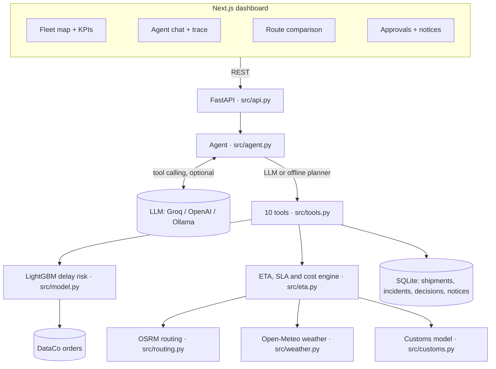
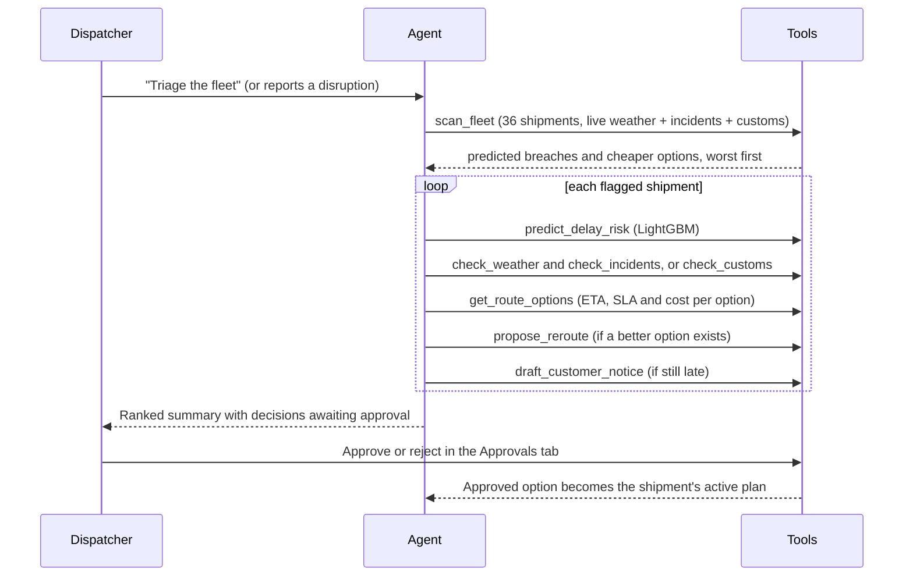
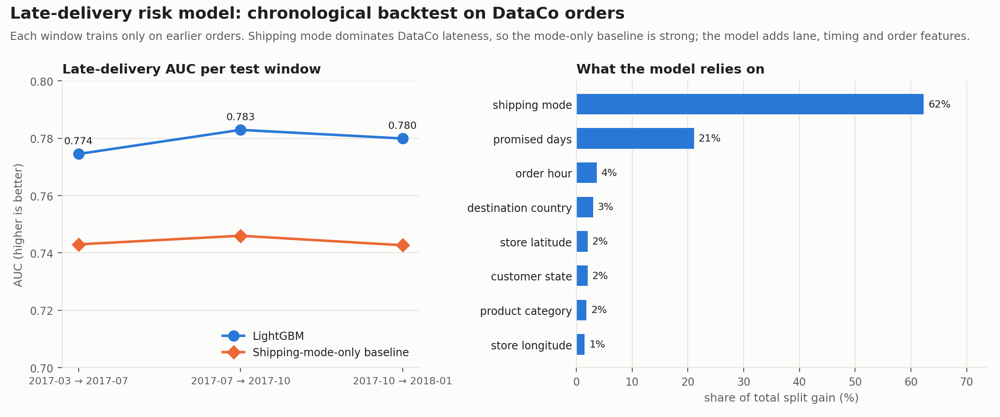
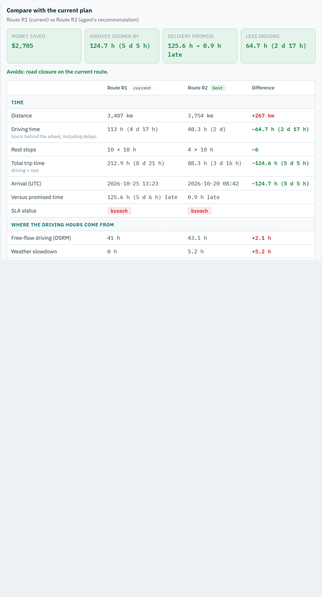
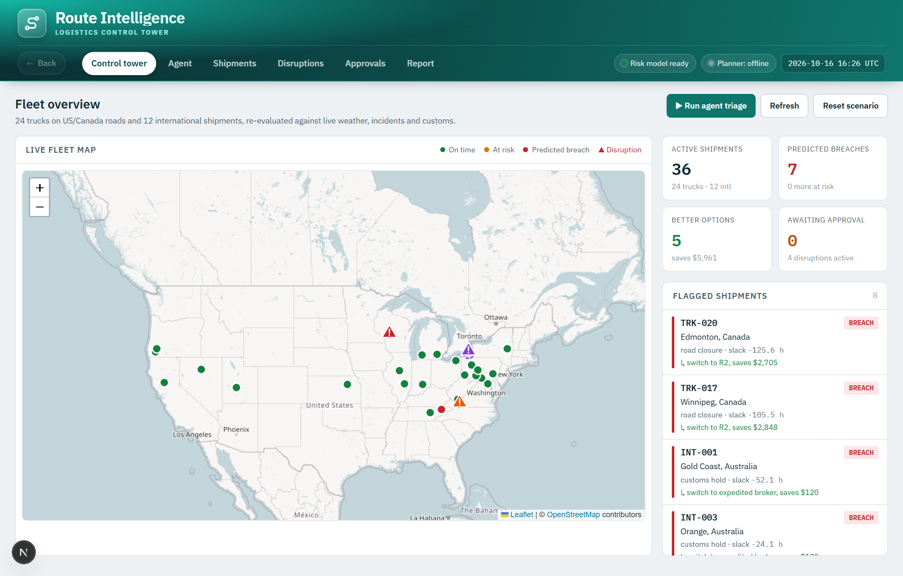
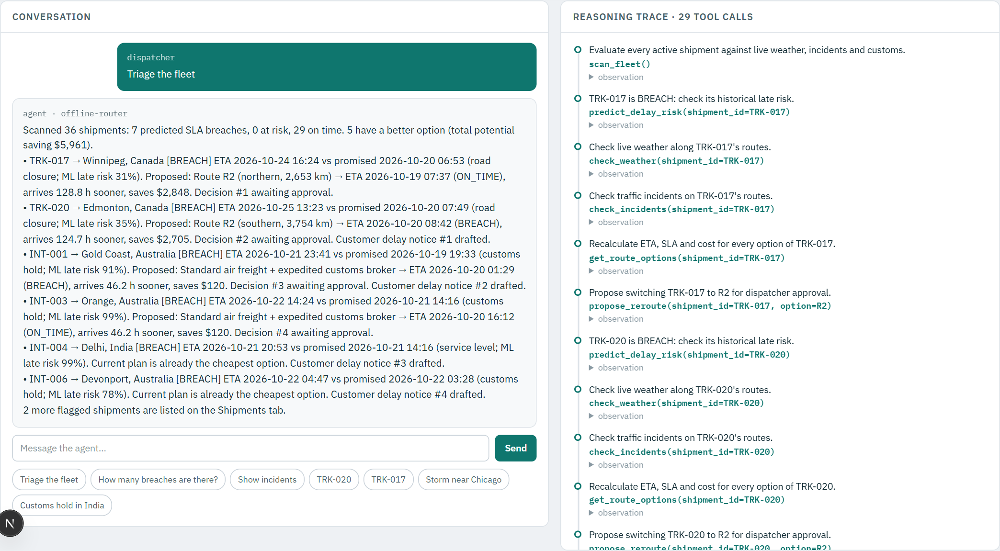
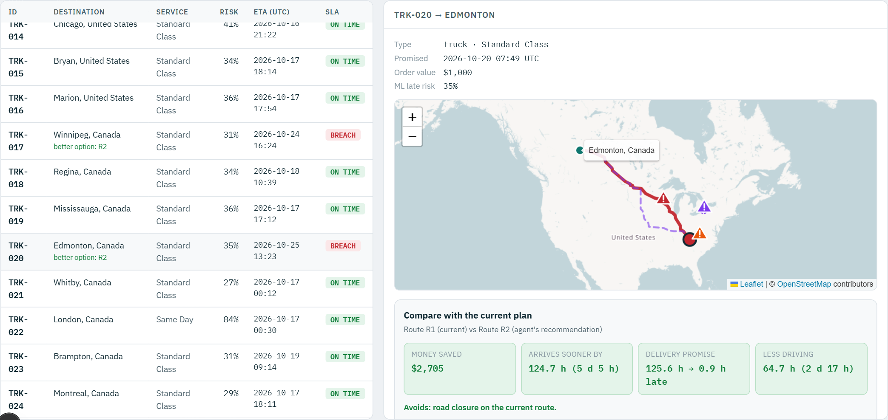
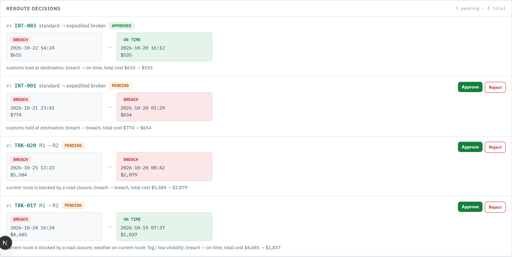
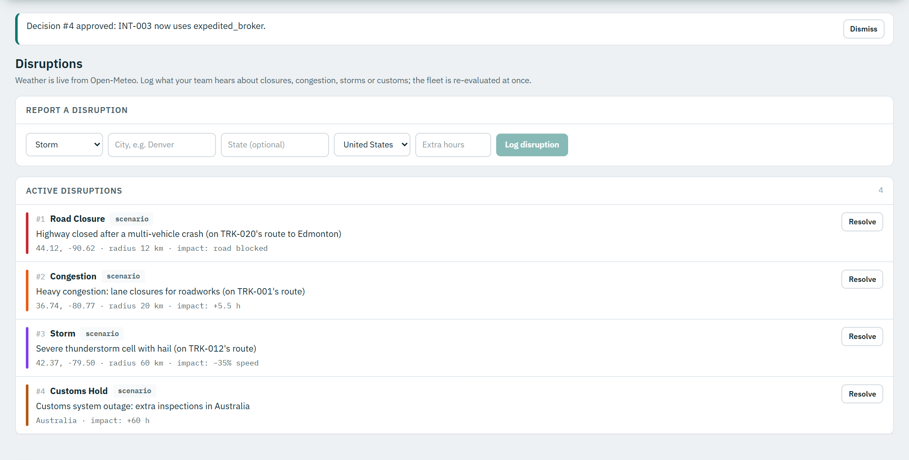

# Route Intelligence Agent: Report

Latentsig review assignment, problem statement 1 (Route Intelligence on logistics disruptions).

## 1. The business problem

Logistics teams run dozens of vehicles at once while traffic congestion, extreme weather and
customs delays keep changing the plan. A static routing system picks a route at dispatch and
never revisits it, so:

- **Costs go up:** trucks sit behind closures or crawl through storms, burning fuel and overtime.
- **SLAs are breached:** late deliveries trigger customer penalties.
- **Dispatchers are overloaded:** someone has to notice each problem, compare alternative routes and
  recalculate ETAs vehicle by vehicle.

This agent does that work continuously. For every active shipment it checks live weather,
traffic incidents and customs status, recalculates the ETA on every available route, compares
total cost (fuel, driver time and SLA penalties), and proposes the best option to a dispatcher.
It also drafts the customer notice when a delivery will still be late.

## 2. Requirement coverage

| Brief asks for | Where it is |
|---|---|
| A small model used as a tool | `src/model.py`: **LightGBM** late-delivery risk model trained on DataCo (tool `predict_delay_risk`) |
| Agentic workflow for the logistics pain point | `src/agent.py`: "Triage the fleet" workflow over 10 tools (Section 4) |
| Traffic congestion | Incident feed (closures, congestion) applied to real road routes; `check_incidents`, `report_disruption` |
| Extreme weather | Live **Open-Meteo** forecasts along every route; `check_weather` |
| Delayed customs clearances | Customs model with holds, expedited-broker and express-air options; `check_customs` |
| Adapt routes dynamically | Real alternative routes from **OSRM**; `get_route_options`, `propose_reroute` |
| Recalculate ETAs across dozens of vehicles | `scan_fleet` evaluates all 36 shipments in parallel (24 trucks, 12 international) |
| Cut costs and SLA breaches | Cost model: fuel + driver hours with overtime + SLA penalty; picks the cheapest total |
| DataCo Smart Supply Chain dataset | 180,519 order lines → 65,752 orders (Section 5) |
| Free open-source APIs and models | OSRM, Open-Meteo, OpenStreetMap tiles, LightGBM; optional free Groq LLM |
| Report on architecture and workflow | This document and `docs/ARCHITECTURE.md` |
| Bonus: realistic, good UI/UX | Next.js dashboard: two-row header with a Back button, live fleet map, agent chat and trace, side-by-side route comparison, approvals (Section 8) |
| AI tools used | Section 10 |

## 3. Architecture



**Planners.** With an API key (Groq is free) an LLM chooses the tools through OpenAI-compatible
function calling, for up to 10 steps. Without a key, an offline planner detects the intent and runs
fixed multi-step plans with the same tools. Either way, every call is shown in the UI's reasoning
trace with its thought, arguments and full observation.

## 4. The agentic workflow ("Triage the fleet")



A dispatcher can also just say what they heard, for example *"Road closed near Denver"*. The agent
geocodes the place, logs the incident, and immediately re-triages the fleet against it.

Example output (offline planner, live weather at the time of writing):

> **TRK-017 → Winnipeg, Canada [BREACH]** ETA 2026-10-24 16:29 vs promised 2026-10-20 06:58 (road
> closure; ML late risk 31%). Proposed: Route R2 (northern, 2,653 km) → ETA 2026-10-19 07:42
> (ON_TIME), arrives 128.8 h sooner, saves $2,848. Decision #1 awaiting approval.

In this scenario a single triage run makes 29 tool calls in a few seconds. It finds 7 predicted
SLA breaches and 5 better options worth about $5,960 in total, proposes the reroutes for approval,
and drafts the customer notices for shipments that will still be late. Exact numbers change with
the live weather.

## 5. Data

- **Source:** Kaggle *DataCo SMART SUPPLY CHAIN FOR BIG DATA ANALYSIS* (180,519 order lines,
  January 2015 to January 2018). The lines are condensed to **65,752 orders**
  (`data/dataco_slim.parquet`, 2.3 MB, committed), so the app runs without the 96 MB raw download.
- **What it provides:** store coordinates (the origin), destination city, state and country, shipping
  mode, scheduled vs real shipping days, the late-delivery flag, market and region, product and
  order value.
- **Today's fleet is a replay.** The most recent DataCo orders are re-dated so they are in transit
  now:
  - **24 trucks** run from mainland-US stores to 16 US and 8 Canadian cities.
  - **12 international** shipments fly to Asia-Pacific and clear customs.

  Promised delivery times come from DataCo's scheduled days. Only orders a carrier could normally
  meet are picked, so the risks come from disruptions, as in real operations.
- **Live external data:**
  - road routes and alternatives from OSRM;
  - hourly weather for the next 48 h from Open-Meteo;
  - destination coordinates from Open-Meteo geocoding.

  Routes and coordinates for the demo fleet are cached in the repo, so it also works offline.
- **Assumptions, documented in `src/config.py` and `src/customs.py`:**
  - truck fuel use and price, driver wage, overtime after 8 h, an 11 h daily driving limit with 10 h
    rest;
  - SLA penalty of 5% of order value per day late (minimum $150);
  - typical customs clearance hours by country.

  DataCo contains none of these.
- **Disruptions:** a seeded scenario (a highway closure, roadworks congestion, a thunderstorm cell
  and a customs outage, each placed on real routes), plus anything a dispatcher reports.

## 6. The ML tool: late-delivery risk model

- **LightGBM** `LGBMClassifier` predicting DataCo's `Late_delivery_risk`: learning rate 0.1,
  37 trees, 63 leaves, averaged over 5 random seeds. An order counts as "predicted late" when
  its risk is at least 0.57.
- **Features known at dispatch:** shipping mode, promised days, store location, destination
  market/region/country, customer segment and state, department, category, payment type, and
  order weekday, month and hour.
- **Columns excluded because they leak the answer:** delivery status, real shipping days, order
  status, shipping date.
- **Role in the agent:** it gives each shipment's *historical* risk for its lane and service level.
  The ETA engine then adds the *live* disruptions on top.

### Evaluation: 3-window chronological backtest

Each test block (about 6,300 orders) is evaluated with a model trained only on orders before it.

| Model | AUC | Accuracy | Brier (lower is better) |
|---|---:|---:|---:|
| **LightGBM (tuned)** | **0.779** | **72.5%** | **0.176** |
| LightGBM before tuning (lr 0.05, 300 trees) | 0.780 | 71.5% | 0.178 |
| Shipping-mode-only baseline | 0.744 | 69.6% | 0.188 |
| Overall late rate | 0.500 | 57.3% | 0.245 |



### Tuning the learning rate and settings

Tuning used a separate **validation period** (train on the oldest 60% of orders, validate on the
next 10%), so the three test windows above were never used to choose anything
(`scripts/tune_model.py` reproduces it).

- **Grid:** 144 settings were tried, with early stopping: learning rate 0.01, 0.02, 0.05 and 0.1;
  7 to 63 leaves; 40 to 400 minimum samples per leaf; and three feature sets.
- **Learning rate:** 0.1 with early stopping at about 34 trees matched or beat the slower rates.
  The pattern in DataCo is simple, so extra trees at a low rate only learn noise.
- **Features:** order value, quantity and line count were dropped because they carry no lateness
  signal and added noise.
- **Threshold:** the "late" cut-off of 0.57 was chosen on the validation period.
- **Seed averaging:** averaging 5 seeds steadies the probabilities.
- **Result:** accuracy rose from 71.5% to 72.5% and Brier improved from 0.178 to 0.176.
- **Tried and rejected:** leak-free history features (late rates per lane and per mode × country,
  mode × state and so on, known 7 days before dispatch). They gave no gain (AUC 0.778 vs 0.780).

**Why accuracy is not 98%:** within one shipping mode, DataCo's late flag behaves almost randomly.
Standard Class is late 40% of the time and Same Day 53%, whatever the lane, product or timing.
The only columns that reach about 100% are delivery status and real shipping days, which are
known only *after* delivery and would be leakage.

**DataCo has a known quirk, and it matters here:** lateness is driven mostly by shipping mode. For
example, First Class is late 95% of the time, always by exactly one day. A model that only knows
the mode already reaches AUC 0.744. LightGBM improves on it consistently in every window, using
lane, timing and order features, but it is not a dramatic gain, and the report says so rather than
overclaiming. Predicting the *number* of delay days was also tested and does not beat the per-mode
average, so the agent uses the model as a risk score and computes ETAs from live conditions.

## 7. ETA, SLA and cost logic

**Trucks.** Each OSRM route from the truck's current position to the destination is evaluated:

```
drive_h  = free-flow hours × (1 + worst weather penalty or storm penalty) + congestion hours
         + 72 h if a road closure is on the route (stranded until reopened)
wall_h   = drive_h + 10 h rest after every 11 h of driving
ETA      = now + wall_h
SLA      = ON_TIME (≥ 4 h slack), AT_RISK (0–4 h), BREACH (late)
cost     = fuel (km × 32 L/100 km × $1.05) + driver wages (overtime ×1.5 after 8 h/day)
         + SLA penalty (5% of order value per day late, minimum $150)
```

Weather penalties come from the live forecast at 5 points along each route: rain −6%, heavy
rain −15%, snow −15% to −35%, strong or high wind −8% or −20%, thunderstorm −20%, fog −12%.

**International shipments.** Air transit, then customs clearance (typical hours for the country plus
any active hold), then last-mile delivery. The options are standard clearance, an expedited customs
broker (+$180, 55% faster clearance) and express air (+$520).

**Decision.** The agent recommends the option with the lowest *total* cost (fuel + driver wages +
SLA penalty), and only when it saves money:
- **Paying more can be cheaper.** A longer route or a customs broker costs more up front but can
  remove a large SLA penalty, so the agent proposes it.
- **Sometimes it isn't.** For a shipment only an hour late, a broker costs more than the penalty, so
  the agent keeps the plan and drafts a customer notice instead.
- **No extra spending on shipments that are on time.** If a shipment is on time and every other
  option costs more, nothing is proposed. The Shipments page says "No other route proposed" and hides
  the propose buttons. An on-time shipment is only offered another route when that route is cheaper
  (for example, TRK-001 saves $168 on R2).

### Side-by-side comparison: what a reroute changes

For every alternative, the engine also returns a full breakdown and a comparison with the current
plan (`eta.compare`). The UI shows it as a table and the agent quotes it in its proposals.
- **Time:** distance, driving hours, rest stops, total trip time and arrival time.
- **Where the hours come from:** free-flow, weather, storm, congestion and closure hours.
- **Driver and fuel:** regular and overtime hours, average speed, diesel litres and CO₂.
- **Cost:** fuel, driver wages, SLA penalty and total.

**Worked example (TRK-020 to Edmonton, live run):** route R1 runs into the highway closure, and the
agent proposes R2.

| | R1 (current) | R2 (proposed) | Difference |
|---|---:|---:|---:|
| Distance | 3,487 km | 3,754 km | +267 km |
| Driving time | 113 h (incl. 72 h stranded) | 48.3 h | −64.7 h |
| Rest stops | 10 | 4 | −6 |
| Total trip time | 212.9 h | 88.3 h | −124.6 h (5 d 5 h sooner) |
| Late against the promise | 129 h | 4.3 h | −124.7 h |
| Diesel / CO₂ | 1,116 L / 2,991 kg | 1,201 L / 3,220 kg | +85 L / +229 kg |
| Fuel | $1,172 | $1,261 | +$90 |
| Driver wages | $3,512 | $1,467 | −$2,044 |
| SLA penalty | $900 (6 days) | $150 (1 day) | −$750 |
| **Total cost** | **$5,584** | **$2,879** | **−$2,705** |

The detour is 267 km longer and burns 85 L more diesel. But it avoids three days stranded at the
closure, so the driver works 65 fewer hours and the order arrives five days sooner. That cuts the
wages and the penalty far more than the extra fuel costs. The panel also explains each formula with
the route's own numbers, for example "40 h × $28 + 8.3 h × $42 = $1,467".



## 8. UI/UX

A Next.js 16 + FastAPI app. All screenshots below are from the running app.

The UI is a light "control tower" design: IBM Plex type, monospace for IDs, times and figures,
teal for actions and red or amber only for risk.
- **Header:** a deep-teal header in two rows. The project name is on top. Below it are a
  **← Back** button, the section tabs (as pills), the model and planner status, and a live UTC clock.
- **Back button:** returns to the previous screen, for example from a shipment opened on the map
  back to the Control tower. It remembers up to 20 steps and is greyed out when there is nowhere to
  go back to.

### Control tower: the whole fleet at a glance
A large live map colours each truck by SLA status and marks disruptions with ⚠ icons. Beside it
are KPI tiles (predicted breaches, better options and savings, decisions awaiting approval) and a
feed of flagged shipments, worst first.



### Agent: conversation and reasoning-trace timeline
One click runs the workflow from Section 4. The conversation sits on the left, and every tool call
appears on the right as a step in a timeline, which you can expand to see its arguments and result.



### Shipments: route comparison
The list on the left is filtered to flagged shipments (or All, Trucks, International). Selecting
one shows the detail on the right. On a wide screen the two panels **scroll independently**: you
can scroll through a long comparison without losing your place in the list.
- **Map:** TRK-020's current route (red) runs through the highway closure (⚠), while the dashed
  alternative avoids it.
- **Comparison panel (Section 7):** below the map, it puts the current plan beside the agent's
  recommendation. Any other option can be chosen instead, and "Ask agent to propose" sends that
  exact option for approval.
- **On-time shipments:** when every other option costs more, the panel shows "No other route
  proposed" instead.
- **Option cards:** below the panel, they summarise each route.



### Approvals: the dispatcher stays in control
The agent never changes a route by itself. Each proposal shows a before → after comparison (SLA,
ETA, cost) with the reasons, and a dispatcher approves or rejects it. Customer delay notices are
drafted, not sent.



### Disruptions
Live disruptions, with a form to report new ones (closure, congestion, storm or customs hold) and a
Resolve action. Every change re-evaluates the fleet.



## 9. Demo walkthrough (5 minutes)

1. **Start it:** run `python -m uvicorn src.api:app --port 8100`, then
   `npm --prefix frontend run dev -- -p 3100`, and open http://localhost:3100.
2. **Control tower:** see the predicted breaches on the map. Click a red truck; it opens on the
   Shipments tab with its route comparison. Use **← Back** to return to the map.
3. **Agent:** click **▶ Run agent triage** and follow the reasoning-trace timeline.
4. **Shipments:** open TRK-020 and compare R1 with R2 (time, driving, fuel, CO₂, cost). Then open
   an on-time shipment such as INT-002, where no other route is proposed.
5. **Approvals:** approve a reroute. The shipment switches route and its SLA status updates.
6. **Disruptions:** report "Storm near Chicago" and watch the fleet re-evaluate. Or ask the agent
   "Road closed near Denver".

Optional: put a free `GROQ_API_KEY` in `.env` and restart the backend. The LLM then chooses the
tools itself.

## 10. AI tools leveraged

- **Claude Code (Claude Opus):** design, implementation, testing and documentation of this project,
  including running the app end to end and capturing these screenshots.
- **OpenCode (Claude):** used during the companion demand-forecasting project.
- **LightGBM, scikit-learn (metrics), pandas, PyArrow, FastAPI, Next.js, React-Leaflet.**
- **Free services:** OSRM routing (FOSSGIS and project-osrm.org), Open-Meteo weather and geocoding,
  OpenStreetMap map tiles.
- **LLM planner (optional):** Groq `llama-3.3-70b-versatile` (free tier), OpenAI `gpt-4o-mini`, or a
  local Ollama model, all through the OpenAI-compatible client.

## 11. Limitations and next steps

- **Simulated parts:** the fleet's positions, the incident scenario and the cost and customs figures
  are simulated or assumed. DataCo has no telematics, traffic or customs data. A real deployment
  would take GPS positions from a TMS and incidents from a traffic feed such as TomTom or HERE
  (these need API keys).
- **No live traffic speeds:** OSRM durations are free-flow. Live speeds would require a paid traffic
  API.
- **Weak model target:** DataCo's late flag is dominated by shipping mode, which limits how much any
  model can learn. Real carrier data, with route-level delay history, would make the risk model far
  more useful.
- **Next steps:** live traffic speeds, multi-stop routes, carrier and mode switching for trucks,
  scheduled scans every few minutes, and sending approved notices by email or SMS.
